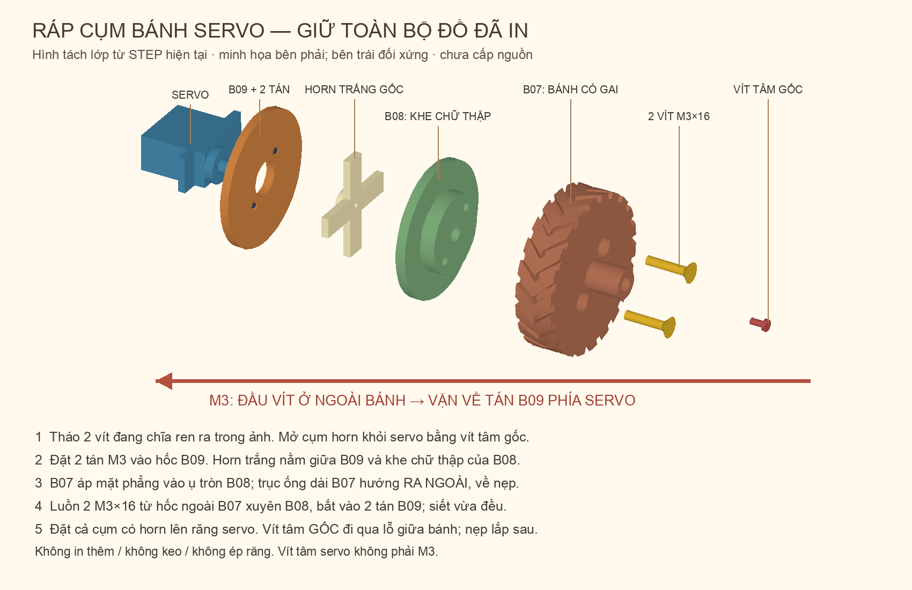

# Ráp cụm bánh servo · sửa hướng dẫn 20/10

**Lượt này không cần in thêm.** Dùng lại toàn bộ bánh07, vòng08/09/15, servo, horn trắng và vít đã có. R5 trục/bánh sau không đổi. Hướng dẫn trước thiếu hình tách lớp và chiều vít, nên không đủ rõ để ráp thật.



## Đối chiếu IMG_2277

Ảnh thấy hai đầu ren chĩa ra mặt ụ tròn của B08, và vòng B09 còn ở ngoài. CAD dùng hai M3×16 đi **chiều ngược lại**: đầu vít ở mặt NGOÀI bánh07, tán ở vòng09 phía servo. Ảnh chỉ xác định được chiều/trình tự này; không đo được chiều dài vít hay răng horn, chưa kết luận linh kiện thật đúng hết kích thước.

Nhận đúng ba món:

- **B07**: bánh có gai. Mặt có ống trục dài và hai hốc lớn là mặt NGOÀI, về phía nẹp06. Mặt phẳng còn lại áp vào ụ tròn B08.
- **B08**: vòng lớn có ụ tròn nhỏ nhô ở một mặt; mặt sau có khe chữ thập ôm horn trắng. Ụ tròn hướng RA bánh07; khe chữ thập hướng VỀ servo.
- **B09**: vòng mỏng rời trong ảnh, có hai hốc lục giác. Mặt hốc tán hướng VỀ servo, mặt còn lại áp lên horn/B08.

Mặt cắt, từ trong thân ra ngoài:
```
SERVO / răng → [B09 + 2 tán] → [horn trắng gốc nằm trong khe B08] → [B08 ụ tròn] → [B07 bánh gai, ống dài ra ngoài]
                      ↑                                         ←← 2 M3×16: đầu vít ở hốc NGOÀI B07
Răng servo  ←──────────── vít tâm GỐC qua lỗ GIỮA bánh và B08 ───────────────────────────────────
```
Hai M3 giữ các món nhựa kẹp horn; vít tâm gốc giữ horn vào răng servo. Đây là hai việc khác nhau. **Không lấy M3 vặn vào tâm servo.** B15/nẹp06 ở ngoài, lắp SAU khi đã bắt vít tâm.

## Làm ngay với cụm trong ảnh

1. Ngắt cả nguồn servo và USB. Tháo hai vít đang chĩa ren ra khỏi B08. Tháo vít tâm gốc, nhấc cụm horn khỏi răng thẳng theo trục, không bẻ/xoay cưỡng ép hộp số.
2. Làm ngoài bàn: đặt hai tán M3 vào hốc B09. Đặt horn trắng trong khe chữ thập B08, rồi B09 áp phía sau giữ horn. Các hốc tán ở mặt ngoài phía servo. Giữ mặt tán ngửa trong lúc ghép để tán không rơi; chưa cần keo.
3. B07 quay đúng mặt: **ống dài ra ngoài**, mặt phẳng áp lên ụ tròn B08; căn hai lỗ vít. Chưa gắn nẹp06/B15.
4. Luồn hai M3×16 từ hai hốc lớn phía ngoài B07 xuyên qua B08 vào hai tán B09. Bắt cả hai vài vòng rồi siết đều vừa chặt. Đầu vít nằm trong hốc B07; **không còn hai đầu ren lòi ra phía bánh như ảnh**. Tán phải vào đúng hốc, không xoay tròn hoặc kẹp lệch horn.
5. Đưa cả cụm có horn lên răng servo. Vít tâm GỐC đưa qua lỗ giữa bánh/B08, dùng tua vít nhỏ thẳng trục để siết. Bản tham chiếu có lỗ thông5.6mm, đã kiểm thân tua vít3mm; đồ thật còn phải thử. Nếu horn không tự vào răng bằng lực nhẹ thì dừng, không dùng vít kéo ép vào và không khoan răng.
6. Lắp B15 drive (vòng ngoài của bánh trước) rồi nẹp06 như cũ. Giữ nguyên thân và các miếng vá R5 phía sau. Ráp kín dây/vỏ rồi kiểm không cạ; không xoay cưỡng ép servo. Muốn thử bánh trước quay tự do thì tách horn khỏi răng; bánh sau quay nhẹ cả hai chiều.

Nếu vít không tới tán, không tự đổi sang vít dài hơn chọc phía servo. Chiều dài16, đầu chìm7×2 và horn35×7 là giả định của CAD; phản hồi ráp thật sẽ quyết định miếng nhỏ nào cần vá. Không cắt/glue đồ tốt để ép khớp với mô hình.

## Đã kiểm gì

[Kiểm đường ráp](reports/drive-assembly.json) dùng STEP/hardware hiện tại: cả bên trái/phải, thả tán vào B09 trước horn, horn vào khe B08, B09 đóng từ phía servo, bánh07 từ ngoài, hai M3 từ ngoài vào, vít tâm qua lỗ giữa và đường tua vít.16 đường lắp, bước0.5mm; không sửa/hạ ngưỡng các check cũ. Răng spline, độ chặt, đúng vít/horn thực và kết quả ráp lại vẫn pending. Không flash hoặc chạy servo.

Trong [Overview](overview.html), chọn **“Ráp bánh servo — xem riêng”**, kéo **Tách lớp**, nút **Mặt khe chữ thập / tán** để xem mặt sau. Các món lấy từ STEP đã xuất, chỉ dịch để minh họa; không có thay đổi STL/STEP/plate. Điều khiển live chưa được kiểm do browser security chặn HTML cục bộ; đã kiểm cú pháp script và ảnh tách lớp tĩnh.
